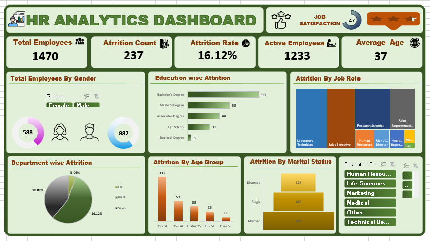
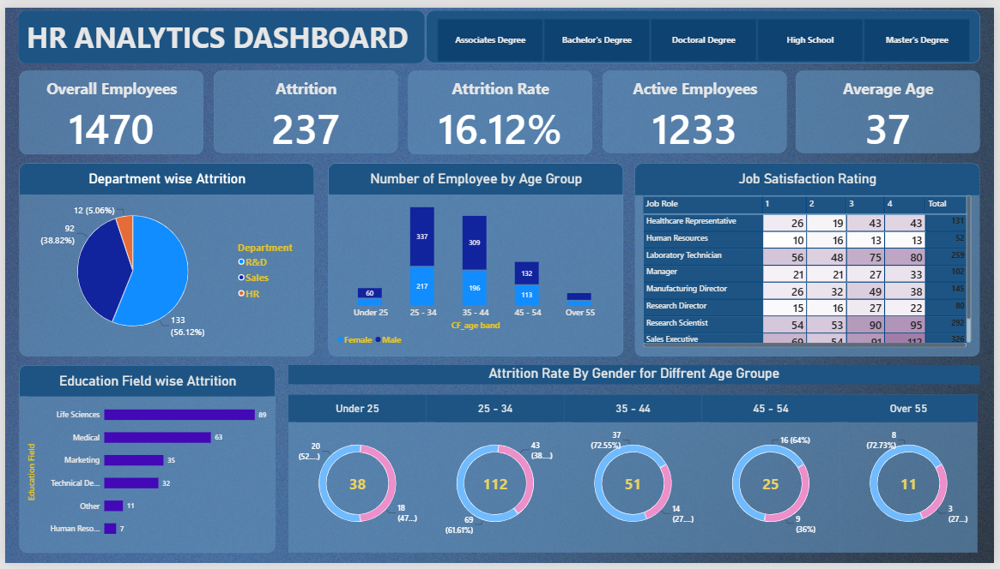

# HR Analytics & Employee Attrition Analysis

## Project Overview

This project analyzes employee data to understand workforce characteristics and identify patterns related to employee attrition.

The analysis was performed using **Microsoft Excel** and **Power BI**, with a focus on HR KPIs, employee demographics, job roles, departments, satisfaction factors, overtime, and attrition patterns.

The project transforms raw HR data into interactive dashboards and business insights that can support data-driven HR analysis.

---

## Project Objectives

The main objectives of this project are to:

* Analyze overall employee attrition.
* Calculate key HR performance indicators.
* Identify attrition patterns across departments and job roles.
* Analyze attrition by age group and gender.
* Examine the relationship between overtime and attrition.
* Analyze attrition by marital status and education field.
* Explore employee satisfaction and other HR-related factors.
* Build interactive dashboards using Excel and Power BI.

---

## Dataset

The dataset contains information about **1,470 employees** and includes **40 variables** covering different HR-related aspects.

Key fields include:

* Employee information
* Age
* Gender
* Department
* Job Role
* Education
* Marital Status
* Business Travel
* Overtime
* Monthly Income
* Job Satisfaction
* Environment Satisfaction
* Work-Life Balance
* Performance Rating
* Years at Company
* Total Working Years
* Attrition

---

## Tools Used

* **Microsoft Excel**

  * Data analysis
  * PivotTables
  * KPI calculations
  * Charts
  * Dashboard

* **Microsoft Power BI**

  * Data visualization
  * Interactive dashboard
  * Slicers
  * KPI cards
  * HR analytics

---

## Dashboard

### Excel Dashboard

The Excel dashboard provides an overview of employee attrition using KPI cards, charts, and interactive filters.



### Power BI Dashboard

The Power BI dashboard provides an interactive view of HR metrics and attrition patterns.



---

## Business Insights

The analysis identified several notable patterns in the dataset:

* The overall employee attrition rate is **16.12%**.
* The **Sales department** has an attrition rate of approximately **20.63%**, compared with **13.84%** in R&D and **19.05%** in HR.
* **Sales Representatives** have an attrition rate of approximately **39.76%** in this dataset.
* Employees **under 25** have an attrition rate of approximately **39.18%**.
* Employees working **overtime** have an attrition rate of approximately **30.53%**, compared with **10.44%** among employees without overtime.
* **Single employees** have an attrition rate of approximately **25.53%**, compared with **12.48%** for married employees.
* Employees who travel frequently have an attrition rate of approximately **24.91%**.

These findings describe patterns in the dataset and can be used as starting points for further HR analysis.

---

## Project Structure

```text
HR-Analytics-Employee-Attrition/
│
├── Excel/
│   └── HR Data.xlsx
│
├── Power BI/
│   └── HR Analytics Dashboard.pbix
│
├── screenshots/
│   ├── excel-dashboard.png
│   └── power-bi-dashboard.png
│
├── Business Insights.docx
│
└── README.md
```

---

